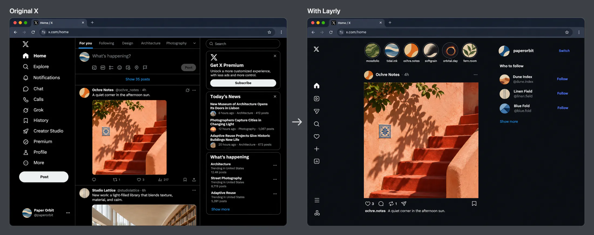

# Layrly

**What if scrolling X felt like browsing Instagram?**

I wanted to see a photo first and read the post underneath it, while still following the people I follow on X. Layrly is my experiment with that idea. It is a small Chrome extension that rearranges the page in your browser. Your timeline, media and interactions still come from X.

**Start with the X home feed.** It is the only page I consider usable for everyday testing, and it still has bugs. I am sharing this personal project so that someone interested in another page, language or interaction can build on what already works.

*Illustrative comparison using fictional accounts and posts.*

## Try it in Chrome

1. Download and extract this repository using **Code → Download ZIP**, or clone it with Git.
2. Open `chrome://extensions`, enable **Developer mode**, and choose **Load unpacked**. Select the extracted folder containing `manifest.json`.
3. Open or refresh the X home timeline. Open **Layrly** from Chrome’s extensions menu and select **Instagram Layout**.
4. Choose **Original X** in the same popup to switch back.

The extension runs directly from source. Node.js is only needed for development.

## What to expect

| Area | Current state |
| --- | --- |
| X home | Single-column photo feed, captions below media, and locally rendered text cards for posts without a picture. The left rail groups extra X controls under More. |
| X notifications | Experimental side panel with native notifications, date groups and an unread indicator. Different account layouts still need testing. |
| X profiles, Explore and post detail | Partial layouts. Virtualized grids can fall back to one column, and media or navigation may look wrong. |
| Instagram → X | An early compact timeline and profile-grid experiment. It needs more work across real pages and locales. |

One detail I cared about was keeping the heart still when a like count changes from 99 to 100. Another was finding a place for X-specific actions without crowding the feed. If you pick up one of these interactions, try it with the extension both on and off.

## Help with one page

A small, reproducible bug report is welcome. Include the page type (home, profile, detail or notifications), Chrome version, operating system, page language, and what you expected to happen. Use fictional data or redact account details in screenshots.

For a first patch, pick one interaction and one page. The site adapters live in `platforms/x/` and `platforms/instagram/`. Shared route detection and cleanup live in `core/`. The local page fixtures in `tests/fixtures.cjs` let you reproduce markup changes without sharing a signed-in account. [Open issues](https://github.com/yilun-x/layrly/issues) · [Contributor guide](CONTRIBUTING.md)

## Privacy and license

Layrly stores layout preferences on your device. The extension has no backend or telemetry. Layrly is an independent project with its own navigation artwork and has no affiliation with X or Instagram.

[Privacy details](PRIVACY.html) · [MIT license](LICENSE)
